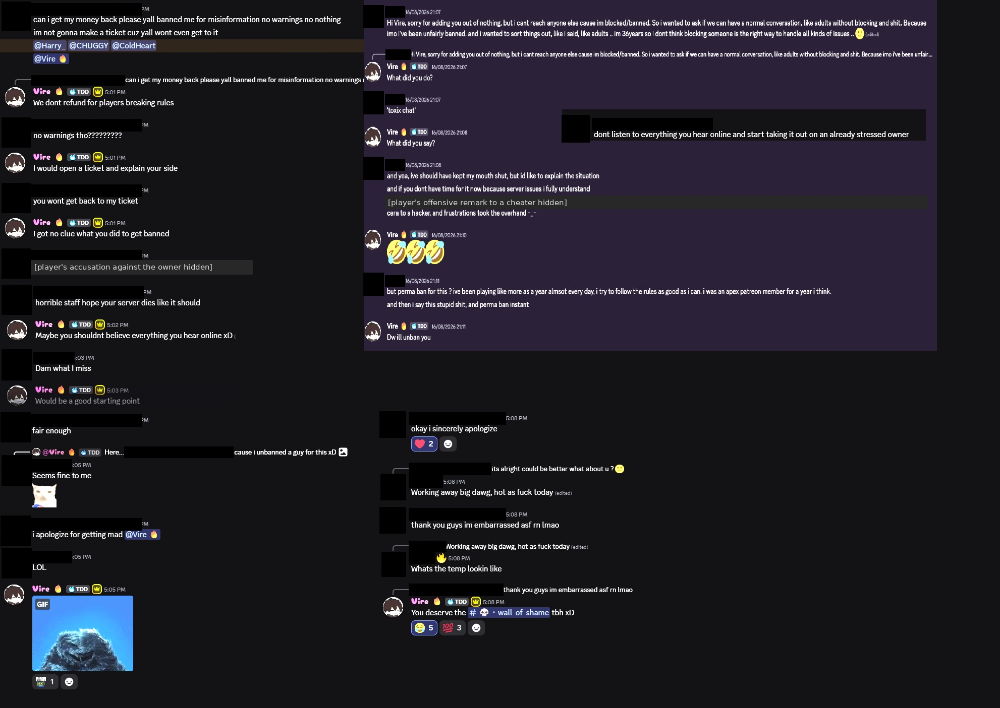

# 05 — How the owner and staff treat players: Dino Den's own Discord

Source: screenshots of two **public channels** in The Dino Den's Discord server, `#wall-of-shame` and `#sent-to-hell`, taken by the author by 27 October 2026, who holds the originals. Dates are as Discord shows them. Under this repository's rules, players' names and avatars are hidden, and staff are named by the handles they use as staff. Roles come from Dino Den's own Discord (screenshots taken by the author, 27 Oct 2026): Vire is the only holder of the server's "Founders" role; CHUGGY's profile lists Head Admin, Senior Admin, Admin and TDD Staff; the member list shows ColdHeart under Head Admin and Harry_ under Server Directors, and Harry_'s profile lists Server Directors, Community Manager, Admin and TDD Staff. The owner's and the bot's words are quoted. What players wrote is mostly described rather than reproduced; short phrases are quoted where needed to show what the owner was answering. One redacted screenshot is published, for the exchanges that the findings rest on. Some posts contain private messages that the owner or staff made public by posting them; they are described here only as they appeared in the public channel.

## `#wall-of-shame`

The channel starts on 15 August 2026. In the posts captured (15 August – 22 October 2026), the owner, Vire, made nine posts and a Head Admin, CHUGGY, made two. Most of them show screenshots of other people's messages, for the server to react to (posts drew up to 86 laughing reactions):

| Date | Posted by | What was shown |
|---|---|---|
| 15 Aug 2026 | Vire | A player's messages from a support ticket, answered with a GIF captioned *"WHAT THE FUCK"* |
| 18 Aug 2026 | CHUGGY (Head Admin) | Two players' conversations with the owner after being banned (see below), captioned *"I appreciate the humility W"* and tagging the refund player |
| 18 Aug 2026 | CHUGGY (Head Admin) | Private messages from the owner of a different server to a third person, asking them to join his staff, captioned *"Don't be this guy folks."* |
| 19 Aug 2026 | Vire | A player's private message and friend request to the owner |
| 19 Aug 2026 | Vire | A sexual private message a player sent the owner, captioned *"Yall gotta stop sending me this shit"* |
| 5 Sep 2026 | Vire | Players' messages forwarded from the public `au-chat` channel |
| 21 Sep 2026 | Vire | A clan's boastful message from a forum thread, captioned *"Yes, they seem quite nice 🤣"* |
| 21 Oct 2026 | Vire | A player's in-game chat message to the owner |
| 22 Oct 2026 | Vire | A player's private message to the owner offering something sexual in exchange for a dinosaur |

Two other posts in the period (21 Aug and 8 Sep) show a message from CHUGGY and one from HEX, who posts as staff on Dino Den's website news. They are not about players.

### Two banned players, shown in the channel on 18 August

*Screenshot provided by the author. Players' names, avatars and clan tags, and two offensive lines (described below), are hidden. Staff handles are shown.*

**A refund request.** In a Discord channel, a banned player tagged the owner and three staff members (Harry_, a Server Director, and the Head Admins CHUGGY and ColdHeart), asked for their money back, said they were banned *"for misinformation"* with *"no warnings"*, and said they would not open a ticket. The owner replied:

- *"We dont refund for players breaking rules"*
- *"I would open a ticket and explain your side"*
- after the player said a ticket would not be answered: *"I got no clue what you did to get banned"*

The player then said what they had posted: an accusation against the owner, which they attributed to *"disgruntled staff"*. (In the same chat the owner linked accusations of this kind to the unban described below.) They added *"horrible staff hope your server dies like it should"*. The owner replied *"Maybe you shouldnt believe everything you hear online xD"*. The player apologised twice and said they were embarrassed; the owner's reply to that was *"You deserve the #wall-of-shame tbh xD"*. When CHUGGY posted the exchange in `#wall-of-shame`, his caption, tagging the player, was *"I appreciate the humility W"*.

**A permanent ban, and a promise to lift it, over private messages.** A player messaged the owner directly (16 August 2026) to say he had been permanently banned for one offensive remark to a cheater, and that he had been *"an apex patreon member for a year i think."* The owner asked *"What did you do?"* and *"What did you say?"*, replied to the explanation with three laughing emojis, then wrote *"Dw ill unban you"*. In the refund exchange above, the owner had posted an image with a message saying he was being criticised *"cause i unbanned a guy for this xD"*. The image is not visible in the screenshot, but the timing makes it most likely this player.

## `#sent-to-hell`: a ban trap

A notice posted by Dino Den's own bot ("TDD Auto Ban") on 15 August 2026, headed *"DO NOT TYPE IN THIS CHANNEL"*, says:

- *"This is a ban trap. Sending anything here — a message, a meme, a sticker, a GIF, even a single letter — gets you instantly banned."*
- *"No warnings. No second chances."*
- *"Instant ban, zero exceptions"*; *"Your last 7 days of messages get deleted from the whole server"*; *"The whole server gets told about it"*

The channel description reads: *"Souls claimed: 403 🔥 Type here and join them 😈"*.

## What can and cannot be concluded

**Can be concluded:**
- The owner and a Head Admin use a public channel in Dino Den's Discord to post other people's messages, including private messages and support-ticket messages, for the community to react to. The owner told a banned player he *"deserve[d]"* to be posted there.
- The owner refused a refund on the grounds of rule-breaking while saying he had *"no clue"* why the player was banned. He also suggested the player open a ticket. The player then said they had posted an accusation against the owner.
- The owner told a permanently banned player, by private message, that he would unban him, and later wrote that he had *"unbanned a guy for this"*. This happened outside the ticket process the FAQ describes; the Terms call moderation decisions *"final."*
- Dino Den runs a channel whose bot notice, headed *"DO NOT TYPE IN THIS CHANNEL"*, says anyone who posts in it is instantly banned, while the channel's own description invites people to post. The channel's own count is *"Souls claimed: 403"*.

**Cannot be concluded:**
- Who banned the refund player and on what exact grounds. The player's own account is that it followed an accusation they posted about the owner; the screenshot does not show whether the owner himself was involved in that decision.
- Whether the refund was for a Patreon payment, or how other ban appeals are handled.
- Whether the `#sent-to-hell` bans also apply to the game servers or the website, or only to Discord, and how many of the 403 were spam bots or hacked accounts rather than players.
- Counterpoint: [trap channels](https://discordbotlist.com/bots/honeypot/upvote) are a known Discord tool against spam bots and hacked accounts that post in every channel, and the 403 may include many of those. The concern is that this channel's description invites people to type there.
- Counterpoint: the refund player had posted an accusation against the owner and wished the server would die, then apologised. The owner's *"no clue"* came before the player explained.
- Counterpoint: several of the private messages the owner posted were unsolicited sexual or harassing messages sent to him. Posting them may be how he responds to harassment, rather than an attempt to shame players.

See also [DISCREPANCIES.md §12](../DISCREPANCIES.md#12-moderation-in-practice-vs-the-terms-and-faq) and the README's [Staff and owner conduct](../README.md#staff-and-owner-conduct) section.
